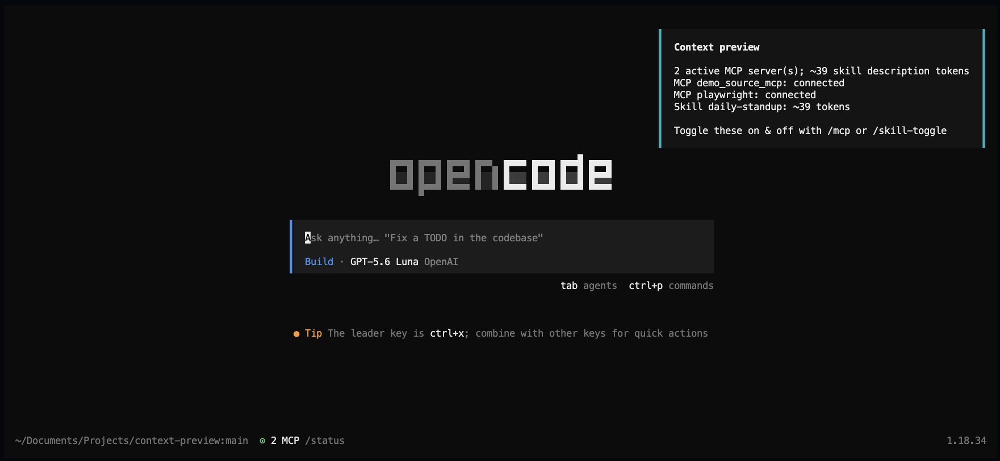

# OpenCode Context Preview

An OpenCode plugin to remind you to turn off skills and MCP servers



This plugin lists connected MCP servers and estimates how many tokens agent skill descriptions will add to the model context. It shows an itemized startup preview (a TUI toast when the CLI plugin is enabled, with a server-log fallback), caches a report for a local CLI command, and can toggle skills for the current OpenCode runtime.

## How it Works

When OpenCode starts, the plugin builds a report and displays an itemized startup preview. It lists configured MCP servers that are enabled and currently `connected`. It discovers skills from the project and parent `.opencode`, `.claude`, and `.agents` directories, their global equivalents, and any configured skill paths (`skills.paths` in V1 or `skills` in V2). This includes Claude-compatible skills imported by OpenCode from `.claude/skills`. Only valid skill files are included; V1 applies skill permissions during discovery, while V2 reconciles permissions with the model-visible inventory before provider submission.

### Context Cost Estimates

The plugin estimates the context added by each skill's metadata, not the full contents of its `SKILL.md` file. For every discovered skill, it serializes this object:

```json
{"name":"skill-name","description":"Skill description"}
```

It counts Unicode characters in that serialized string, divides the count by four, and rounds up. The total shown in the preview is the sum of those per-skill estimates. When OpenCode sends its actual `<available_skills>` inventory, the plugin parses that inventory and reconciles the cached report with the names and descriptions that will be submitted to the provider.

### Disabling Skills

`/skill-toggle off <name>` (or `/skill-toggle <name>` to toggle) records the disabled name for the current project. The setting is shared by OpenCode sessions for that project. V1 toggling starts a new session to clear the old conversation context; start a new session manually after toggling in V2.

For a disabled skill, the plugin:

- Removes its `<skill>` entry from OpenCode's `<available_skills>` system-prompt section.
- Removes the skill name and description wherever they appear in transformed system text and in the skill tool description.
- Rejects direct attempts to execute the skill tool for that skill.

The command is handled locally and does not make an LLM request. Configured skill permissions still take precedence, so a skill denied by OpenCode cannot be enabled with this command.

The report is cached locally so `opencode-context-preview` can display it without making an LLM request. In V1, if the first prompt arrives before the startup preview is visible, the plugin shows the preview and blocks that request before it reaches the model; text is restored when possible, while attachments must be reattached. V2 logs the preview and does not provide TUI prompt restoration.

## Install

The plugin is installed automatically by OpenCode. Add its npm package name to
`~/.config/opencode/opencode.json`:

```json
{
  "$schema": "https://opencode.ai/config.json",
  "plugins": ["opencode-context-preview"]
}
```

Restart OpenCode after changing the plugin configuration.

For V1, keep using the singular `plugin` key:

```json
{
  "$schema": "https://opencode.ai/config.json",
  "plugin": ["opencode-context-preview"]
}
```

The package also keeps a V1 `server` compatibility entrypoint. The combined
entrypoint is supported by OpenCode V1.18.29 and newer; older V1 releases
should remain on the pre-migration package and its legacy `plugin` tuple
configuration.

Do not install the OpenCode plugin globally with npm. OpenCode downloads npm
plugins with Bun and caches them under `~/.cache/opencode/node_modules/`.
When upgrading, use the exact published version so OpenCode does not reuse a
stale `latest` cache entry:

```sh
opencode plugin add opencode-context-preview@0.1.3
```

Replace `0.1.3` with the version being installed.

The V1 plugin retries briefly while the TUI attaches. If the first prompt arrives before the startup preview appears, the plugin displays the preview and stops that request before it reaches the model. Prompt text is restored when possible; attachments must be reattached before resending. If the preview cannot be displayed, the request is also blocked by default. V2 logs the preview instead because server plugins do not have a TUI API.

For headless or automated use, disable this first-prompt gate with a plugin option:

```json
{
  "$schema": "https://opencode.ai/config.json",
  "plugins": [
    {
      "package": "/absolute/path/to/context-preview",
      "options": { "blockFirstPrompt": false }
    }
  ]
}
```

V2 server plugins do not have a TUI API; the startup preview is written to
the plugin log instead. The report and toggle files use the same cache format
as V1.

To use `/skill-toggle` in the V2 TUI, also enable the package's CLI plugin in
the global `~/.config/opencode/cli.json`:

```json
{
  "$schema": "https://opencode.ai/v2/cli.json",
  "plugins": ["opencode-context-preview"]
}
```

The `opencode.json` entry loads the server plugin; the `cli.json` entry loads
the TUI companion. It displays the startup preview and surfaces server-side
`/skill-toggle` toasts without registering a second `/skill-toggle` command.
For a local checkout, use
`{"package":"/absolute/path/to/context-preview"}` in the `plugins` array
instead. Restart the TUI after changing either file.

## View the full report

The report command is optional and is separate from installing the OpenCode
plugin. Disabled skills are excluded from the cached report, startup preview, and
skill token total. Install the package globally to make its executable available:

```sh
npm install --global opencode-context-preview
opencode-context-preview
```

Alternatively, run it without a global install:

```sh
npx --yes opencode-context-preview
```

The command searches the current directory and its parents for the latest cached report without making an LLM request. Add `--json` for machine-readable output or `--help` for usage. Restart OpenCode after changing configured MCP servers or installed skills. The plugin also reconciles the cache with the actual skill inventory before a provider request.

Reports and project-scoped skill toggle preferences are cached under `~/.cache/opencode/context-preview/` by default. Toggle preferences are stored as `<project-path-hash>.toggles.json`, next to the corresponding `<project-path-hash>.json` report cache. Set `OPENCODE_CONTEXT_PREVIEW_CACHE_DIR` to use a different directory for both files.

## Toggle skills

Use the plugin's `/skill-toggle` command to inspect or change skill availability for the current OpenCode runtime:

```text
/skill-toggle
/skill-toggle review
/skill-toggle off review
/skill-toggle on review
/skill-toggle toggle review
/skill-toggle off all
/skill-toggle on all
```

With no arguments, the command lists known skills and their `on` or `off` state. Passing only a skill name toggles it. Use `on all` or `off all` to change every known skill at once. Skill names must match exactly.

In V1, changing a skill starts a new session to clear stale conversation context. In V2, start a new session after changing a skill to clear the existing context. Toggle state is cached per project alongside the context preview report. A disabled skill is removed from the provider's skill inventory and skill-tool description, matching references in system instructions are redacted, and direct attempts to load it are blocked.

The command is handled locally without an LLM request. Toggle preferences are stored under the local context-preview cache directory (or `OPENCODE_CONTEXT_PREVIEW_CACHE_DIR` when set). Configured skill permissions still take precedence.

## What is counted

- **MCP servers:** configured, enabled servers whose current status is `connected`. Their tool schemas and instructions are not counted.
- **Skills:** valid discovered skill names and descriptions. V2 reconciles the startup registry report with OpenCode's permitted `<available_skills>` system-prompt inventory before provider submission; V1 applies its configured permission rules during discovery.

Each skill estimate covers the serialized name and description and uses Unicode character count divided by four, rounded up. The displayed skill total is the sum of those estimates. MCP entries are status listings only; other system-prompt content is not counted.

## Development

```sh
npm test
```

### Publish a new version

After updating the plugin, run the tests, bump the package version, and publish
the package to npm:

```sh
npm test
npm version patch
npm publish
```

Use `minor` or `major` instead of `patch` when appropriate. `npm version`
creates a Git commit and tag. Push them to the repository separately:

```sh
git push --follow-tags
```

The package uses `@opencode/plugin` for its V2 entrypoint. Its plugin entry point is `index.js`; the executable is `bin/context-preview.js`.
